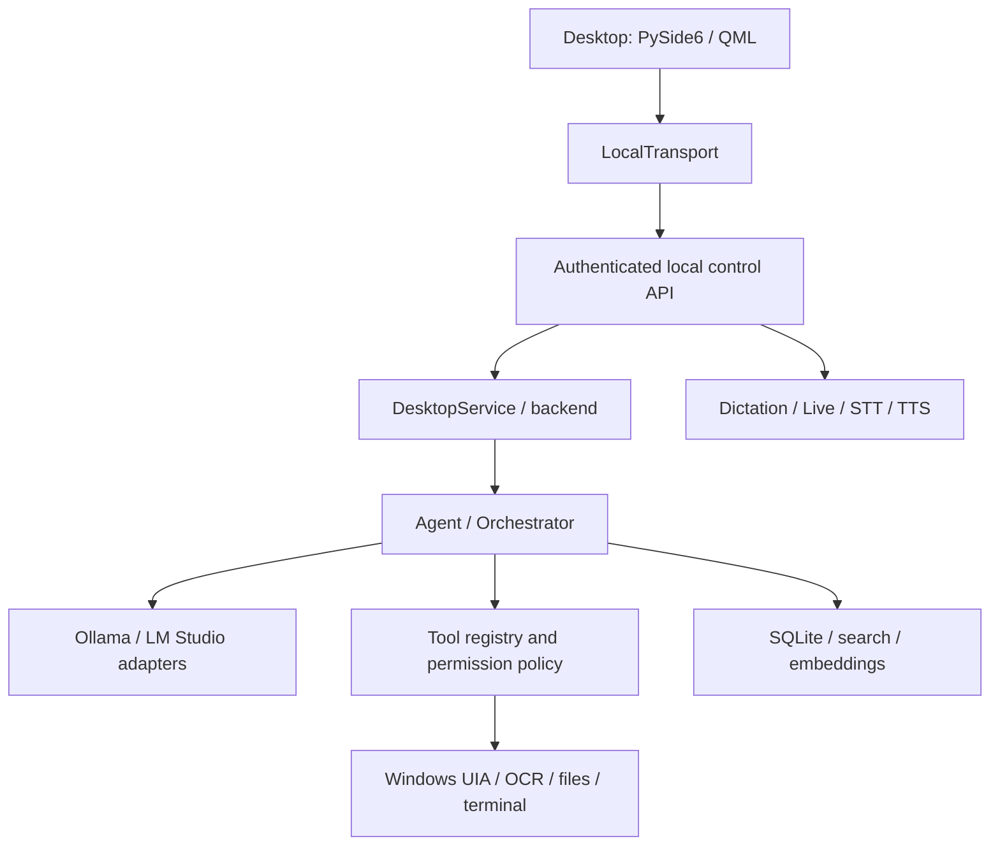

[Русский](README.md) | **English**

<p align="center"></p>

# Onyx

A local AI assistant for Windows, evolving into an open agent workspace.

    

> 🚧 **Actively under development**
>
> The source implements a desktop client, local models, voice, memory and tools. Quality depends on configuration and hardware; automated tests do not replace real-world checks. The agent platform and plugins remain a development direction. UI, APIs and structure may change. A stable public release and complete security boundary are not claimed.


*Current QML scene in isolated visual mode: no backend, microphone or user history. This demonstrates the interface, not a model session. [Image provenance](docs/assets/README.md).*

## What is Onyx?

Onyx combines chat, local language models, voice input, memory and Windows tools. Beyond conversation, it can retrieve saved context, observe the desktop and execute tools according to selected permissions.

The long-term goal is a personal computing environment combining user-selected models, providers, agents, presets, workspaces, tools, plugins and access rules. This is **not yet a finished agent builder**.

## Why it exists

- Make the user's computer and local models a first-class foundation.
- Reduce dependence on cloud subscriptions for every interaction.
- Keep model choice, important data storage and settings under user control.
- Combine conversation, voice, memory and actions instead of separate utilities.
- Gradually enable extensions without waiting for one vendor.

**Local-first, not local-only.** Cloud providers may become optional extensions; they are not advertised as a finished current desktop feature.

## The interface

The sidebar contains Apps, Chat, Settings, search, pinned conversations and projects. The center shows a conversation or Onyx Pearl welcome screen. The composer offers attachments, model selection, dictation and Live. Settings covers appearance, models, voice, Live, internet, Git and data. Apps catalog entries alone do not mean external coding agents are connected.

## Implemented today

“Implemented” means integrated in source, with limitations alongside it.

| Area | Current state |
| --- | --- |
| Desktop | Python / PySide6 / QML, streaming, cancellation, reconnection, RU/EN and appearance settings. |
| Chats and projects | History, pinning, archive, export, text attachments and logical groups. Workspace folders are separate; groups do not merge conversation context. |
| Models | Ollama, chat-model selection and local management. An LM Studio adapter exists; full UI-operation parity with Ollama is not promised. |
| Voice | Dictation, Live, faster-whisper STT and local TTS. Weights and audio setup are required; echo, interruptions and live speech need hardware-specific checks. |
| Memory | SQLite, search, embedding context, saving and forgetting memories. Forgetting does not remove all historical copies. |
| Vision and Windows | UI Automation, OCR, vision model; application, window, file and terminal tools. Results depend on applications and permissions. |
| Internet | Local or local-plus-internet modes for managed routes; search with sources. Not a network sandbox for arbitrary processes. |
| Git | Selected project folder, specific-file review before commit; separately reviewed push, unavailable offline. |
| Windows and displays | Geometry persistence and recovery after display changes; unit and acceptance checks. No universal monitor-configuration guarantee. |

## In development and planned

**Currently evolving:** desktop/backend resilience, voice, model management and context. Provider adapters, tool registry and permission policy exist, but do not constitute a finished new platform.

**Architecture direction:** ProviderRegistry / ModelRegistry, ToolBroker / PermissionBroker, AgentRuntime, presets, workspaces and plugin lifecycle. Unintegrated or uncommitted foundations are excluded from ready features.

**Plans without dates:** plugin management, Plugin Market, agent builder, broader coding/automation and community extensions. A public marketplace, complete sandbox and universal AgentRuntime are not claimed as implemented.

## Architecture

The client is separate from the backend. Local control uses bearer authentication; this protects transport, not tool execution isolation.



Modules: [onyx_desktop](onyx_desktop/), [kk/core](kk/core/), [kk/providers](kk/providers/), [kk/tools](kk/tools/), [kk/memory](kk/memory/), [kk/voice](kk/voice/). The future plugin platform is not drawn as a working component.

## Local-first and data

History and memory are local; Ollama runs inference on the selected machine. Offline use requires locally available models/dependencies and disabled network features.

Model downloads, search and network tools use the internet. Configured provider addresses may point elsewhere. “Data never leaves the device” would be inaccurate. Online mode alone does not authorize cloud inference or automatic Git push.

Tools can change files and control the computer. The `safe`, `normal`, `full` profiles, confirmations, audit and Emergency Stop do not replace a sandbox: `full` can execute registered tools without confirmation. Start with restricted permissions. [Windows recovery](docs/RESTORE_WINDOWS.md).

## Models

Chat/reasoning produces answers and plans; vision interprets images; embeddings retrieve memory. Coding uses language models and tools; a separate universal coding platform is not promised.

Installed models depend on configuration. Names in `config.toml` describe the current profile, not a mandatory inventory. [Model management](docs/MODEL_MANAGEMENT.md). Weight licenses are separate from code licenses.

## Voice: Dictation and Onyx Live

**Dictation:** speech → editable draft → user sends it. The composer microphone should not automatically turn dictation into a command.

**Onyx Live:** spoken conversation with recognition/playback inside the current app; background mode is separate. STT uses faster-whisper, Russian TTS local Silero, English Windows SAPI. Weights must be available beforehand. Native wake-word is experimental; echo and interruption require live hardware checks.

## System requirements

- Windows x64; Linux/macOS support is not claimed.
- Python 3.12+ in `pyproject.toml`; the dependency snapshot and build target Python 3.12.
- PySide6 / QML, requirements dependencies and Ollama for the main model path.
- Microphone/audio output for voice. Current `config.toml` selects CUDA STT; adapt it for incompatible hardware.
- RAM, VRAM and storage depend on model size/quantization and concurrent STT, vision and chat. No universal minimum is verified; the developer's particular GPU is not required.
- The bundle **build** requires 8 GiB available RAM; this is not a runtime minimum.

## Installation and launch

### From source

Commands were checked against existing scripts/entrypoints. A clean Windows installation was not performed in this documentation task. In the cloned repository root with Python 3.12:

```powershell
py -3.12 -m venv .venv
.\.venv\Scripts\python.exe -m pip install -r requirements-lock.txt --extra-index-url https://download.pytorch.org/whl/cpu
.\.venv\Scripts\python.exe -m pip check
```

`requirements-lock.txt` is a Windows snapshot, not a portable hash lock. Configure Ollama, model roles and audio in `config.toml`; separately prepare models and voice weights. `pip install` does not do that. Web dependencies use [setup-web.ps1](setup-web.ps1).

```powershell
.\run-app.ps1
```

The client can launch the backend through its existing launcher. Separate backend commands:

```powershell
.\run.ps1 --doctor
.\run.ps1 --background
.\run.ps1 --status
```

### Desktop bundle

[build-app.ps1](build-app.ps1) and [install-client.ps1](install-client.ps1) support the standalone client. The bundle excludes the full model backend and weights. Build scripts do not imply an available stable GitHub Release.

```powershell
.\build-app.ps1
.\install-client.ps1 -Bundle <path-to-Onyx.dist>
```

The installer checks the manifest and smoke launch before creating a shortcut; older versions remain. [Desktop client](docs/DESKTOP_APP.md), [recovery](docs/RESTORE_WINDOWS.md). Historical reports describe specific builds.

## Development and tests

Stack: Python, PySide6/Qt Quick/QML, local backend, Ollama, SQLite and Windows APIs. Unittest covers models, history, memory, voice boundaries, tools, network and UI contracts. Test counts are not permanent quality claims.

```powershell
.\.venv\Scripts\python.exe -m unittest discover -s tests
```

Live/GUI acceptance needs its own scenario and hardware. Use only explicitly isolated roots for backend acceptance under [acceptance_scope.py](onyx_desktop/acceptance_scope.py). Visual mode shows real QML without backend/history:

```powershell
.\run-app.ps1 --visual-test --smoke-seconds 4 --screenshot <path-to-image.png>
```

## Roadmap

1. Strengthen the local foundation, voice and recovery.
2. Separate providers, models and capabilities.
3. Stabilize agents, presets, workspaces and access rules.
4. Add plugin management, then catalog and agent builder.
5. Expand automation and community participation.

No dates are promised. Active development may introduce breaking changes.

## Follow and contribute

Follow commits, issues and future releases in the existing GitHub repository. Report reproducible bugs and send small pull requests. [CONTRIBUTING.md](CONTRIBUTING.md).

## License and third-party components

**An Onyx license has not yet been selected:** no root LICENSE exists. Public source alone does not grant a license to use, modify or redistribute it.

Third-party components and weights have separate terms: [THIRD_PARTY.md](docs/THIRD_PARTY.md), [desktop notices](onyx_desktop/NOTICES.md), and licenses in assets. Silero weight terms must not automatically be equated with Onyx or other dependencies.
