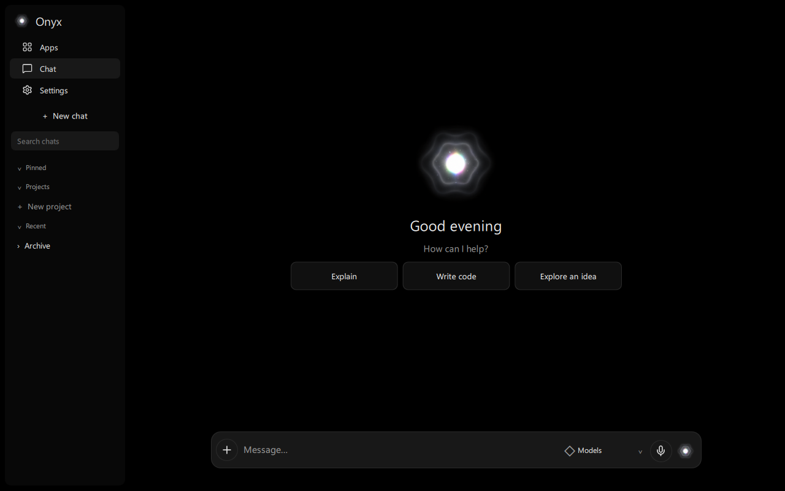
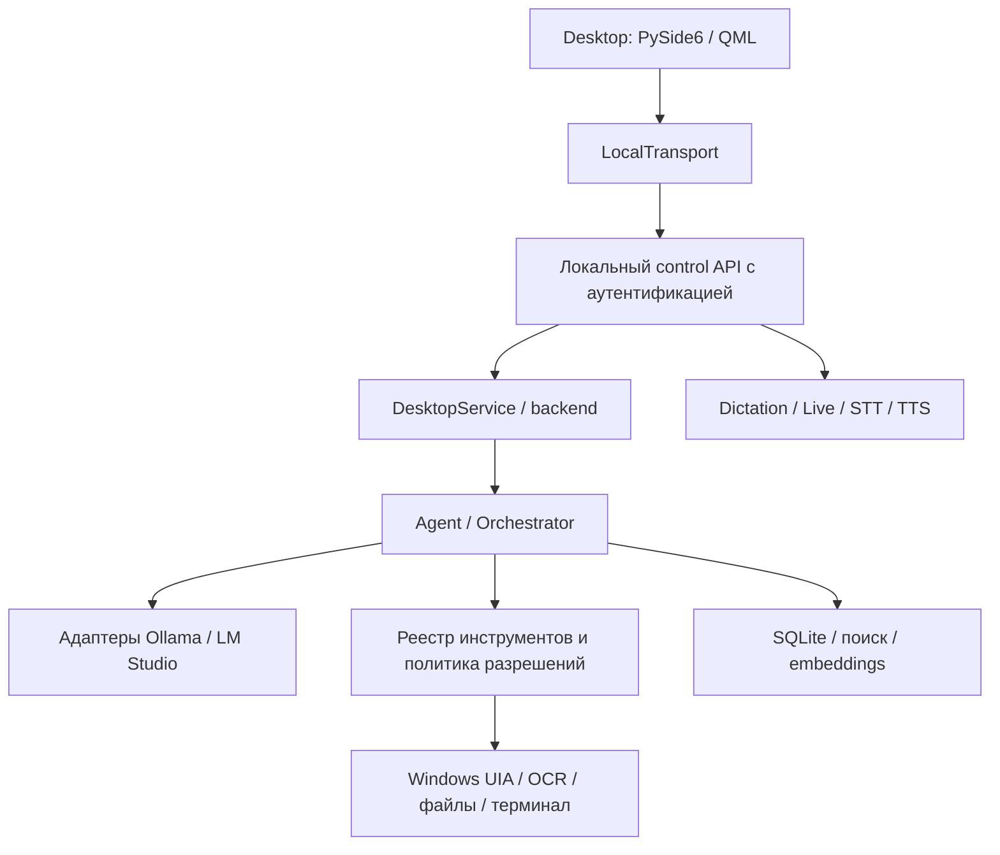

**Русский** | [English](README.en.md)

<p align="center"></p>

# Onyx

Локальный AI-помощник для Windows, который развивается в открытую агентную среду.

    

> 🚧 **Проект в активной разработке**
>
> В исходниках реализованы desktop-клиент, локальные модели, голос, память и инструменты. Их качество зависит от конфигурации и оборудования; автоматические тесты не заменяют проверку реальных сценариев. Агентная платформа и плагины остаются направлением развития. Интерфейс, API и структура проекта могут меняться. Стабильный публичный релиз и законченная граница безопасности не заявляются.



*Текущая QML-сцена в изолированном визуальном режиме: без backend, микрофона и пользовательской истории. Это демонстрация интерфейса, а не модельного сеанса. [Происхождение изображений](docs/assets/README.md).*

## Что такое Onyx

Onyx объединяет чат, локальные языковые модели, голосовой ввод, память и инструменты Windows в одном приложении. Диалог — только часть задачи: помощник может обращаться к сохранённому контексту, наблюдать рабочий стол и выполнять инструменты с учётом выбранных разрешений.

Долгосрочная цель — персональная вычислительная среда, в которой пользователь выбирает модель, провайдера, агента, preset, workspace, инструменты, плагины и правила доступа. Сегодня этот набор **ещё не является готовым конструктором агентов**.

## Зачем он нужен

- Сделать собственный компьютер и локальные модели полноценной основой помощника.
- Снизить зависимость каждого взаимодействия от облачной подписки.
- Оставить выбор моделей, хранение важных данных и настройки под контролем пользователя.
- Объединить разговор, голос, память и действия вместо разрозненных утилит.
- Постепенно открыть расширение возможностей без ожидания одного поставщика.

Принцип — **local-first, а не local-only**. Облачные провайдеры могут стать опциональными расширениями; они не объявлены готовой функцией текущего desktop-клиента.

## Как это выглядит

Слева — Apps, Chat, Settings, поиск, закреплённые беседы и проекты. В центре — диалог или приветственный экран с Onyx Pearl. Внизу — редактор сообщения, вложения, выбор модели, диктовка и вход в Live. Settings содержит настройки внешнего вида, моделей, голоса, Live, интернета, Git и данных. Записи каталога Apps сами по себе не означают подключение внешнего coding-агента.

## Что уже реализовано

«Реализовано» означает наличие интеграции в исходниках; ограничения указаны рядом.

| Область | Текущее состояние |
| --- | --- |
| Desktop | Python / PySide6 / QML, потоковые ответы, отмена, восстановление соединения; настройки RU/EN и внешнего вида. |
| Беседы и проекты | История, закрепление, архив, экспорт, текстовые вложения и логические группы. Папка workspace задаётся отдельно; группа не объединяет контекст бесед. |
| Модели | Ollama, выбор chat-модели и управление локальными моделями. Есть адаптер LM Studio; полная совместимость его UI-функций с Ollama не обещается. |
| Голос | Dictation, Live, faster-whisper STT и локальный TTS. Нужны веса и аудиоконфигурация; эхо, перебивания и живая речь требуют проверки на конкретном оборудовании. |
| Память | SQLite, поиск, embedding-контекст, сохранение и удаление отдельных воспоминаний. Удаление воспоминания не удаляет все исторические копии. |
| Vision и Windows | UI Automation, OCR и vision-модель; инструменты приложений, окон, файлов и терминала. Результат зависит от приложений и разрешений. |
| Интернет | Выбор локального режима либо локального режима с интернетом для управляемых маршрутов; поиск с источниками. Это не сетевой sandbox произвольных процессов. |
| Git | Выбранная папка проекта, просмотр конкретных файлов перед commit; отдельный проверяемый push, недоступный offline. |
| Окна | Сохранение геометрии и восстановление при изменении экранов; unit- и acceptance-проверки. Универсальная гарантия для любых мониторов не заявляется. |

## Что разрабатывается и что запланировано

**Развивается сейчас:** устойчивость desktop/backend, голос, управление моделями и контекстом. Провайдерные адаптеры, реестр инструментов и политика разрешений уже существуют, но не равны завершённой новой платформе.

**Архитектурное направление:** ProviderRegistry / ModelRegistry, ToolBroker / PermissionBroker, AgentRuntime, presets, workspaces и жизненный цикл плагинов. Неподключённые или незакоммиченные заготовки не входят в готовые функции.

**Планы без дат:** управление плагинами, Plugin Market, конструктор агентов, расширенные coding/automation-сценарии и расширения сообщества. Публичный marketplace, полноценный sandbox и универсальный AgentRuntime не заявляются как реализованные.

## Архитектура

Клиент отделён от backend. Локальный control API использует bearer-аутентификацию; это защита транспорта, а не изоляция инструментов.



Модули: [onyx_desktop](onyx_desktop/), [kk/core](kk/core/), [kk/providers](kk/providers/), [kk/tools](kk/tools/), [kk/memory](kk/memory/), [kk/voice](kk/voice/). Будущая платформа плагинов не изображена как работающая часть схемы.

## Local-first и данные

История и память хранятся локально; Ollama выполняет inference на выбранной машине. Работа offline возможна, когда нужные модели и зависимости уже доступны локально и сетевые функции выключены.

Загрузка моделей, веб-поиск и сетевые инструменты используют интернет. Настроенный адрес провайдера может вести на другую машину. Поэтому утверждение «данные никогда не покидают устройство» было бы неверным. Online-режим сам по себе не разрешает облачный inference или автоматический Git push.

Инструменты могут менять файлы и управлять компьютером. Профили `safe`, `normal`, `full`, подтверждения, аудит и Emergency Stop не заменяют sandbox: в `full` зарегистрированные инструменты могут выполняться без подтверждения. Начинайте с ограниченных разрешений. [Восстановление Windows](docs/RESTORE_WINDOWS.md).

## Модели

Роли разделены: chat/reasoning формирует ответ и план, vision интерпретирует изображения, embeddings помогают извлекать память. Coding использует языковую модель и инструменты; отдельная универсальная coding-платформа пока не обещается.

Установленные модели определяются вашей конфигурацией. Имена в `config.toml` — настройки текущего профиля, а не обязательный комплект. См. [управление моделями](docs/MODEL_MANAGEMENT.md). Лицензии весов проверяются отдельно от лицензий кода.

## Голос: Dictation и Onyx Live

**Dictation:** речь → редактируемый черновик → отправка пользователем. Микрофон в редакторе не должен автоматически превращать диктовку в команду.

**Onyx Live:** голосовой разговор с распознаванием и озвучкой в текущем приложении; фоновый режим включается отдельно. STT использует faster-whisper, русский TTS — локальный Silero, английский — Windows SAPI. Нужны заранее доступные веса. Native wake-word экспериментален; эхо и перебивания требуют живой проверки оборудования.

## Системные требования

- Целевая платформа — Windows x64; поддержка Linux/macOS не заявлена.
- Python 3.12+ по `pyproject.toml`; снимок зависимостей и сборка ориентированы на Python 3.12.
- PySide6 / QML, зависимости requirements и Ollama для основного модельного пути.
- Микрофон и вывод звука для голоса. Текущий `config.toml` выбирает CUDA STT: без совместимого оборудования конфигурацию нужно адаптировать.
- RAM, VRAM и диск зависят от размера/квантизации моделей и одновременной работы STT, vision и chat. Подтверждённого универсального минимума нет; конкретная видеокарта разработчика не обязательна.
- Для **сборки** bundle скрипт требует 8 GiB свободной RAM; это не минимум запуска.

## Установка и запуск

### Из исходников

Команды проверены по существующим entrypoint и скриптам. Установка на чистой Windows в этой документационной задаче не выполнялась. В корне клонированного репозитория с Python 3.12:

```powershell
py -3.12 -m venv .venv
.\.venv\Scripts\python.exe -m pip install -r requirements-lock.txt --extra-index-url https://download.pytorch.org/whl/cpu
.\.venv\Scripts\python.exe -m pip check
```

`requirements-lock.txt` — снимок Windows-окружения, а не переносимый lock с хешами. Настройте Ollama, роли моделей и аудио в `config.toml`; отдельно подготовьте модели и голосовые веса. Один `pip install` этого не делает. Web-зависимости устанавливаются отдельным [setup-web.ps1](setup-web.ps1).

```powershell
.\run-app.ps1
```

Клиент может запускать backend через существующий launcher. Отдельные команды backend:

```powershell
.\run.ps1 --doctor
.\run.ps1 --background
.\run.ps1 --status
```

### Desktop bundle

Есть [build-app.ps1](build-app.ps1) и [install-client.ps1](install-client.ps1) для standalone-клиента. Bundle не включает весь модельный backend и веса. Наличие скрипта не означает доступный стабильный GitHub Release.

```powershell
.\build-app.ps1
.\install-client.ps1 -Bundle <путь-к-Onyx.dist>
```

Установщик проверяет manifest и smoke-запуск, затем создаёт ярлык; старые версии сохраняются. [Desktop-клиент](docs/DESKTOP_APP.md), [восстановление](docs/RESTORE_WINDOWS.md). Исторические отчёты относятся к конкретным сборкам.

## Разработка и тесты

Стек: Python, PySide6/Qt Quick/QML, локальный backend, Ollama, SQLite и Windows API. Набор unittest проверяет модели, историю, память, голосовые границы, инструменты, сеть и UI-контракты. Число тестов не используется как постоянное обещание качества.

```powershell
.\.venv\Scripts\python.exe -m unittest discover -s tests
```

Live/GUI acceptance требует отдельного сценария и оборудования. Backend acceptance запускайте только на явно изолированном root по правилам [acceptance_scope.py](onyx_desktop/acceptance_scope.py). Визуальный режим показывает настоящую QML-сцену без backend/истории:

```powershell
.\run-app.ps1 --visual-test --smoke-seconds 4 --screenshot <путь-к-снимку.png>
```

## Roadmap

1. Укрепить локальную основу, голос и восстановление после ошибок.
2. Разделить провайдеры, модели и их возможности.
3. Стабилизировать agents, presets, workspaces и правила доступа.
4. Добавить управление плагинами, затем каталог и конструктор агентов.
5. Расширить автоматизацию и участие сообщества.

Сроки не обещаются. Проект в активной разработке; возможны несовместимые изменения.

## Как участвовать и следить за развитием

Следите за commits, issues и будущими releases в существующем GitHub-репозитории. Сообщайте воспроизводимые ошибки и присылайте небольшие pull requests. [CONTRIBUTING.md](CONTRIBUTING.md).

## Лицензия и сторонние компоненты

**Лицензия Onyx пока не выбрана:** корневого LICENSE нет. Публичные исходники сами по себе не предоставляют лицензию на использование, изменение и распространение.

Сторонние компоненты и веса имеют отдельные условия: [THIRD_PARTY.md](docs/THIRD_PARTY.md), [desktop notices](onyx_desktop/NOTICES.md) и лицензии в assets. Условия Silero-весов нельзя автоматически приравнивать к лицензии Onyx или других зависимостей.
